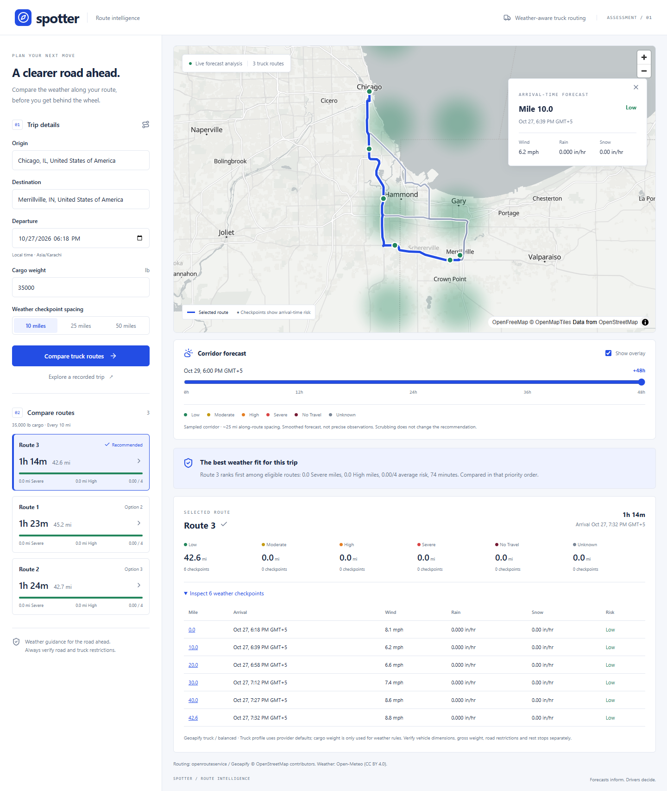

<<<<<<< HEAD
# Spotter — weather-aware truck routing

Compare genuine truck routes using the weather expected **when the truck reaches each checkpoint**. A separate corridor overlay explores the next 48 forecast hours without changing the trip recommendation.

React 19 · TypeScript · Vite · MapLibre GL · Python 3.12 · Django 5.2 · Django REST Framework



## Run locally

Prerequisites: Python **3.12+**, Node **22.12+**, and npm. On Windows, use `py -3.12` if `python` points to an older installation. The development environment used for this handover is `.venv312`.

```powershell
python -m venv .venv312
.\.venv312\Scripts\python -m pip install -r backend/requirements-dev.txt
Copy-Item backend/.env.example backend/.env  # first setup only; do not overwrite existing credentials
npm --prefix frontend ci
```

Set `ORS_API_KEY` and `GEOAPIFY_API_KEY` in `backend/.env`. The supplied keys have already been copied there in this workspace. **Do not commit `.env` or `env.txt`**; both are ignored. No credentials are bundled in the browser. OpenFreeMap provides the basemap without a browser key.

Start two terminals from the repository root:

```powershell
.\.venv312\Scripts\python backend/manage.py runserver 127.0.0.1:8000
npm --prefix frontend run dev
```

Open **http://127.0.0.1:5173**. Vite forwards `/api` to Django. On macOS/Linux, use `.venv312/bin/python` instead.

Select origin and destination from address suggestions, choose departure, cargo weight and checkpoint spacing, then compare routes. Expand checkpoint details or click a marker. Use the forecast slider to explore corridor conditions at a single time.

**Recorded demonstration:** the explicit demo button loads real route geometry and saved weather from October 27, 2026. It requires no backend and is labeled historical. Live failures never silently fall back to demo data.

## Architecture

```text
frontend/src/
  components/       Form, search, route cards, map, forecast controls
  api.ts            Typed HTTP boundary and cancellation
  types.ts          API response contract
  test/             Component and map-source synchronization tests
frontend/e2e/       Deterministic browser journeys
backend/trips/
  providers.py      ORS/Geoapify/Open-Meteo adapters, retries and cache
  geometry.py       Route-distance sampling, step ETAs, deduplication, corridor
  weather.py        Hourly interval matching and unit normalization
  risk.py           Pure classification, exposure and lexicographic ranking
  service.py        Analysis orchestration
  serializers.py    Input validation
  views.py          REST endpoints and safe error responses
docs/               Requirements, provider evidence, deployment, walkthrough, QA
```

No database is needed. HTTP endpoints:

| Endpoint | Contract |
|---|---|
| `GET /api/health/` | `{"status":"ok"}` |
| `GET /api/locations/search/?q=Chicago` | `results: [{label, coordinates: [longitude, latitude]}]` |
| `POST /api/routes/analyze/` | Validated trip → routes, checkpoints, summaries, recommendation, 49 corridor frames |

Example request:

```json
{
  "origin": {"label": "Chicago", "coordinates": [-87.6298, 41.8781]},
  "destination": {"label": "Merrillville", "coordinates": [-87.3311, 41.4731]},
  "departure": "2026-10-27T15:00:00Z",
  "load_lb": 35000,
  "interval_miles": 25
}
```

Replace the example timestamp with a future instant within five days. Timestamps must contain an offset; responses use UTC. Coordinates are always longitude first. Errors use `{"error":{"message":"...","details":{...}}}`; `details` is optional. Partial weather produces explicit Unknown values and warnings, with no recommendation for affected routes.

## Risk and recommendation

| Condition | Low | Moderate | High | Severe | No Travel |
|---|---|---|---|---|---|
| Wind (mph) | <25 | 25–<35 | 35–<45 | 45–<55 | ≥55 |
| Rain (in/hr) | <0.10 | 0.10–<0.25 | 0.25–<0.50 | 0.50–1.00 | >1.00 |
| Snow (in/hr) | <0.5 | 0.5–<1.0 | 1.0–<2.0 | 2.0–3.0 | >3.0 |

The highest hazard wins. Wind ≥45 mph and cargo >30,000 lb means No Travel. Wind ≥35 mph and cargo >40,000 lb means at least Severe. Wind ≥55 always means No Travel. Strict load inequalities are preserved.

The assessment overlaps internal precipitation boundaries. We use the higher category at 0.25/0.50 rain and 1.0/2.0 snow; the explicit `>1.00` rain and `>3.0` snow limits keep those exact endpoints Severe.

Each checkpoint owns the interval between its neighboring distance midpoints. Exposure miles always sum to the provider route distance. Mean risk is distance-weighted on scores 0–4. Unknown is separate, never zero. Eligible routes have no No Travel or Unknown checkpoint. Sort eligible routes by **Severe miles → High miles → average risk → driving seconds**, with route ID as a deterministic final tie-break. If every route is ineligible, recommend none.

## Forecast and map design

Checkpoints follow the actual polyline, scaled to provider distance. Step durations determine ETA; constant-speed interpolation is limited to each step. When steps are absent, the adapter falls back to route-wide duration. Origin and destination are included once.

Open-Meteo hourly rain + showers are preceding-hour millimeter totals, divided by 25.4 for in/hr. Snowfall is preceding-hour depth in centimeters, divided by 2.54. The containing precipitation interval ends at the next whole hour. Wind is interpolated between surrounding hourly instants. Missing fields, invalid units or times outside the forecast window stay Unknown.

The **corridor heatmap is a smoothed, geographically distributed risk field** using MapLibre blurred circle layers. Each sample's color directly represents severity, rather than treating a concentration of points as bad weather. The lattice uses roughly 25-mile longitudinal sampling and ~15-mile north/south offsets, coarsening for long trips to cap it at 100 points. This is a forecast visualization, not observed precipitation radar or a uniform high-resolution grid. The legend and UI disclose the sampling limitation.

All 49 frames are fetched with the trip. Scrubbing updates one GeoJSON source locally; it makes no network calls and leaves checkpoint ETA forecasts and route ranking untouched. The map instance is stable across selections. Its library is loaded separately from the form, with Vite-managed workers. Weather locations are deduplicated to 0.001 degrees, batched in groups of 25, with at most two concurrent batches and a 15-minute cache. Geocoding is debounced and cached for a day.

## Checks

```powershell
.\.venv312\Scripts\python -m pytest backend -q
.\.venv312\Scripts\ruff check backend
.\.venv312\Scripts\ruff format --check backend
npm --prefix frontend test
npm --prefix frontend run lint
npm --prefix frontend run build
npm --prefix frontend run test:e2e
```

Local Playwright uses installed Chrome. CI installs Chromium and mocks external weather/routing/tile responses. For an **opt-in live** browser check (uses provider quota), start both servers, change into `frontend`, and run `node scripts/verify-live.mjs`. See [verification evidence](docs/verification.md).

## Deployment and submission

- [Deployment instructions](docs/deployment.md): root Vercel configuration and DigitalOcean App Platform spec, both ready for Git integration after one-time account configuration.
- [Provider research and live capability results](docs/providers.md).
- [Requirements and assumptions](docs/requirements.md).
- [5–10 minute walkthrough outline](docs/walkthrough.md).

**Not yet published:** a remote GitHub repository, production URLs and a Loom recording still require the repository/account selection and recording. No paid infrastructure has been created. Uploading code alone does not connect Vercel or DigitalOcean: connect each service once, supply environment settings, then subsequent pushes redeploy automatically.

## Practical limits

Truck profiles use provider defaults; cargo weight is not gross vehicle weight, axle load, dimensions or clearance. Verify legal restrictions separately. Driving ETAs omit driver rest stops and real-time traffic. Search is US-scoped. Route alternatives are never guaranteed: the tested Chicago–Merrillville corridor yields three, while Chicago–Indianapolis yields two. Forecasts cover seven days and departures are limited to five; later arrivals can become Unknown. Sampling can miss localized hazards. Free providers have quotas and no guaranteed availability. In-memory caching/throttling is per process; use a shared cache before scaling to multiple workers or instances. The free Open-Meteo service is for noncommercial evaluation; commercial usage needs a suitable plan.
=======
# Weather-aware-truck-routing
>>>>>>> 00d0a1a01bbbdfec1f5cde9c08e838116890f3b2
